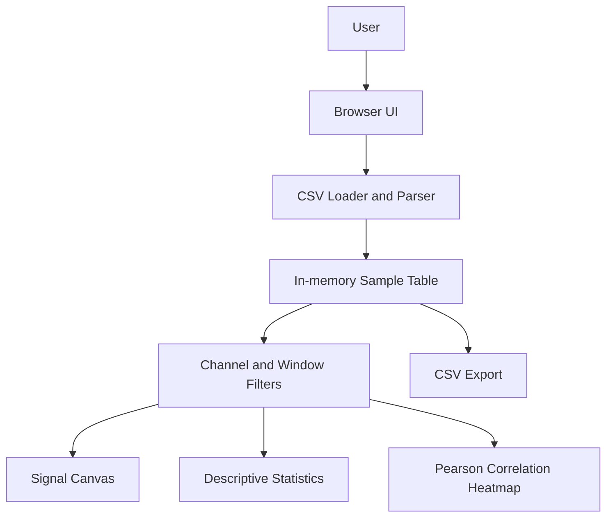

# System Architecture

## Components
- **Browser UI:** HTML and CSS for layout and controls.
- **CSV loader/parser:** reads a local file in the browser; parsing and processing stay on the user's device.
- **In-memory sample table:** stores rows and numeric channel values for the current session.
- **Channel/window filters:** limit the data included in plots and calculations.
- **Visualization layer:** Canvas-based multi-channel chart and correlation grid.
- **Analysis layer:** mean, min, max, population standard deviation, and Pearson correlation.
- **Export:** creates a local CSV download of the selected sample window and channels.

## Data flow
1. The dashboard loads the bundled synthetic sample.
2. The user may select a CSV file from their computer.
3. The parser reads numeric columns and identifies a likely time/sample column.
4. User controls determine the selected channels and sample range.
5. The chart, statistics, correlation heatmap and preview update from the same window.
6. The user can export the selected window.

## Boundaries
The current prototype is a static browser application. It does not include a backend, user accounts, a database, medical interpretation, or specialized MRI/fMRI/MEG/DTI image processing.
